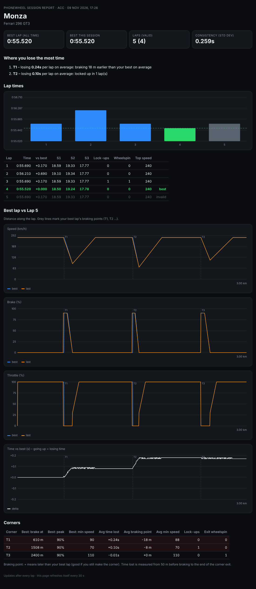

# PhoneWheel

**Turn your Android phone into a GT3-style sim racing wheel for Assetto Corsa Competizione, RaceRoom and Le Mans Ultimate.** Free and open source.

Hold the phone sideways like a steering wheel and tilt it to steer. Your thumbs work **analog brake and throttle strips** on the screen edges. Paddle shifters and a full set of GT3 wheel buttons sit in between. Your PC sees PhoneWheel as an ordinary game controller (through [vJoy](https://github.com/BrunnerInnovation/vJoy)), so it works with any game that supports DirectInput wheels.

PhoneWheel also reads live data from the game. The phone **vibrates** for ABS, lock-ups, kerbs, wheelspin and impacts, shows a **dashboard** with shift lights, and includes a **driving coach** that compares every lap with your best one.

> ⬇️ **Downloads (latest version)**
> - 📱 Phone app: **[PhoneWheel.apk](https://github.com/ihavenoenemies171/PhoneWheel/releases/latest/download/PhoneWheel.apk)**
> - 💻 PC installer (sets up vJoy and the firewall for you): **[PhoneWheel-Setup.exe](https://github.com/ihavenoenemies171/PhoneWheel/releases/latest/download/PhoneWheel-Setup.exe)**
> - 💻 PC portable version: [PhoneWheel-PC.zip](https://github.com/ihavenoenemies171/PhoneWheel/releases/latest/download/PhoneWheel-PC.zip)
> - All versions: [Releases](https://github.com/ihavenoenemies171/PhoneWheel/releases)

---

## Features

**Wheel**
- **Tilt steering** using the gyroscope and accelerometer, with adjustable range, deadzone, smoothing, linearity and optional speed-sensitive steering.
- **Analog brake (left edge) and throttle (right edge).** Slide your thumb up for more. Options include pedal curves, deadzones, brake pressure feel, brake release smoothing and **brake detents** (ticks you feel at 25 / 50 / 75 %).
- **Paddle shifters:** upshift on the left, downshift on the right.
- **Layout editor:** drag buttons around, resize, recolour and rename them, add pages, and add analog **clutch** and **handbrake** levers. You can also change pedal and paddle widths.
- **Profiles:** each one holds a full set of settings plus a layout, and can switch automatically per game or car.
- **Button box mode:** use a second phone or tablet as an extra button box and big dashboard.
- **32 buttons on two pages** in the standard layout.
  - **DRIVE:** pit limiter, lights, flash, wipers, TC ±, ABS ±, engine map ±, brake bias ±, ignition, starter, indicators.
  - **MFD:** arrows, OK, page, hazards, rain light, camera, HUD, ESC, look left / right / back.

**Feedback from the game** (ACC, RaceRoom, LMU)
- **Vibration as force feedback,** each effect with its own rhythm: ABS / lock-up pulses, **understeer** (a soft wobble when the front washes out), **oversteer** (a "ba-dum" heartbeat when the rear goes), kerb knocks, wheelspin rumble, off-track crackle and impact thuds.
  - The default *Essential* mode plays one effect at a time and only what you can act on, so you're never overwhelmed.
- **Screen flashes:** big edge flashes for the brake marker, ABS, wheelspin and the shift point. Each signal can vibrate, flash or both.
- **Dashboard:** shift lights, gear, speed, live delta, TC / TC2 / ABS / MAP / brake bias and fuel (with laps left).

**Driving coach**
- **Live delta** against your best lap, in every game.
- **Brake markers:** "tick-tick" in your thumb and a screen flash just before your best lap's braking points.
- **Corner-by-corner notes,** such as *"T3 brake: 9 m earlier · peak 74% (best 88%) · locked up"* or *"T5 +0.21s: full throttle 0.4 s later · wheelspin"*.
- **Session report** in your browser:
  - lap times, consistency and **theoretical best lap**;
  - a **track map heat map** of where you gain and lose time;
  - traces of your best lap against your last lap;
  - **compare any two laps** (valid or invalid, from any session) side by side;
  - **trail-brake scores** per corner;
  - **where you lose the most time, and why**.
- **Reference laps:** share your best laps, or load a friend's as the reference for your markers and delta.

**Connection**
- **WiFi:** the app finds the PC automatically, and switches the phone to Android's low-latency WiFi mode while it's open.
- **USB tethering:** low lag, and no developer mode needed.
- **USB via adb:** the advanced option.
- **Safety:** if the connection drops, the throttle is cut within 0.4 s and everything is released after 1.5 s. Short WiFi hiccups don't snap the steering to centre.

**Built to last a race**
- Battery-friendly: the screen only redraws when something changes, the sensor and network rates are sensible, and dimming the screen is optional.
- Battery and heat warnings.
- A **diagnostics** screen with a one-tap debug log that uploads to the PC.

**Hardware**
- A **3D-printable GT3 rim** for your phone, parametric for your phone's size. STL and STEP files are included; see [hardware/](hardware/README.md).

<p align="center"><br><em>Example session report (generated from simulated laps)</em></p>

---

## Quick start (about 10 minutes)

You need an **Android phone** (Android 8 or newer) and a **Windows 10/11 PC**.

1. **On the PC, run [PhoneWheel-Setup.exe](https://github.com/ihavenoenemies171/PhoneWheel/releases/latest/download/PhoneWheel-Setup.exe).**
   - It installs PhoneWheel and the **vJoy driver**, sets up the virtual wheel, and opens the firewall.
   - If Windows SmartScreen warns you, click *More info → Run anyway*.
   - Restart the PC if it asks.
2. **Start PhoneWheel** from the Start menu or the desktop shortcut.
3. *Prefer no installer?* Use [PhoneWheel-PC.zip](https://github.com/ihavenoenemies171/PhoneWheel/releases/latest/download/PhoneWheel-PC.zip) and set up vJoy yourself; see the [setup guide](docs/SETUP.md).
4. **On the phone, download [PhoneWheel.apk](https://github.com/ihavenoenemies171/PhoneWheel/releases/latest/download/PhoneWheel.apk)** and install it. Allow *Install unknown apps* when asked.
5. **Connect:** put the phone and PC on the **same WiFi** and open the app. The status line turns green when it has found the PC.
6. **Drive:** hold the phone level, tap **CENTER**, and bind the controls in your game's controls menu.
   - Use **SETUP → Bind controls** for steering, throttle and brake.
   - Tap the wheel buttons to bind them.

👉 **Full step-by-step guide with every option:** [docs/SETUP.md](docs/SETUP.md)

---

## Documentation

| Guide | What's inside |
|---|---|
| [Setup guide](docs/SETUP.md) | Installing everything, all connection methods (WiFi, USB tethering, hotspot, adb), first drive |
| [Game setup](docs/GAMES.md) | Binding controls in ACC, RaceRoom and LMU; telemetry setup (LMU plugin); recommended settings |
| [Features & settings](docs/FEATURES.md) | Every screen, button, setting, vibration effect, the dashboard and the driving coach explained |
| [Troubleshooting](docs/TROUBLESHOOTING.md) | Fixes for the common problems |
| [Building from source](docs/BUILDING.md) | How the project is put together, building the APK and EXE yourself, the network protocol |
| [3D-printable rim](hardware/README.md) | A GT3-style rim that holds your phone: STL and STEP files, parametric for your phone size |
| [Contributing](CONTRIBUTING.md) | How to report bugs, suggest features and send changes |

---

## How it works

```
 Android phone (PhoneWheel app)                         Windows PC (PhoneWheel.exe)
 ┌───────────────────────────────┐   WiFi (UDP)        ┌──────────────────────────────────┐
 │ tilt sensor → steering        │   or USB            │ vJoy virtual wheel ──► the game  │
 │ touch → brake / throttle      │ ──────────────────► │   X = steering, Y = throttle,    │
 │ buttons, paddles              │   ~120 updates/s    │   Z = brake, buttons 1–32        │
 │                               │                     │                                  │
 │ vibration, flashes, dashboard │ ◄────────────────── │ game telemetry (shared memory)   │
 │ coach messages                │   dash + effects    │ driving coach, session report    │
 └───────────────────────────────┘                     └──────────────────────────────────┘
```

- **PC program:** Python (aiohttp), packaged as a single `.exe` with PyInstaller. It feeds vJoy through `vJoyInterface.dll` and reads each game's shared memory.
- **Android app:** Kotlin, using only the plain Android framework (no third-party libraries).
- **Releases:** GitHub Actions builds the APK and the EXE on every push to `main` and publishes them as a release.

## Supported games

| | Controls | Vibration & dashboard | Driving coach |
|---|---|---|---|
| Assetto Corsa Competizione | ✅ | ✅ built in | ✅ |
| RaceRoom Racing Experience | ✅ | ✅ built in | ✅ |
| Le Mans Ultimate | ✅ | ✅ with the free [rF2 Shared Memory plugin](https://github.com/TheIronWolfModding/rF2SharedMemoryMapPlugin) | ✅ |
| Other PC sims with DirectInput wheel support | ✅ | – | – |

## Limitations

- **No real force feedback:** a phone can't push back against your hands, so vibration stands in for it.
- **Android only for the app.** iPhones can use the **browser version** included in PhoneWheel.exe: open `https://<PC-IP>:8766` in Safari. It has steering, pedals and buttons, but no vibration effects or coach.
- **Windows only for the PC program,** because vJoy is a Windows driver.

## License

PhoneWheel is open source under the [MIT License](LICENSE). You can use, copy, modify and share it freely, including in your own projects, as long as you keep the copyright notice.

PhoneWheel isn't affiliated with Kunos Simulazioni, Sector3 Studios / KW Studios, Motorsport Games / Studio 397, or the vJoy project. Game names are trademarks of their owners.

## Credits

- [vJoy](https://github.com/BrunnerInnovation/vJoy): the virtual joystick driver.
- [sector3studios/r3e-api](https://github.com/sector3studios/r3e-api): RaceRoom shared memory layout.
- [TheIronWolfModding/rF2SharedMemoryMapPlugin](https://github.com/TheIronWolfModding/rF2SharedMemoryMapPlugin): rFactor 2 / LMU shared memory.
- ACC shared memory layout as documented by Kunos, cross-checked with [PyAccSharedMemory](https://github.com/rrennoir/PyAccSharedMemory).
