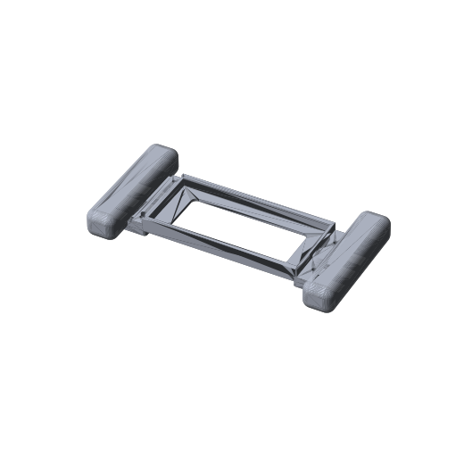

# PhoneWheel GT3 rim (3D-printable)

<p align="center"></p>

A printable steering-wheel rim that holds your phone in landscape. It gives you real grips, a fixed reference for your thumbs on the pedal strips, and less hand fatigue on long stints. Every part fits a **220 × 220 mm** print bed.

> **Status: v0.1, untested.** The cradle and grips are straightforward. The **paddle tapper is experimental**. Measure your phone, print the cradle first, and check the fit before printing everything. Improvements and photos are very welcome (see [CONTRIBUTING](../CONTRIBUTING.md)).

## Files (`out/`)

| Part | Qty | Size (mm) | Notes |
|---|---|---|---|
| `cradle` | 1 | 215 × 85 × 15 | Holds the phone. The phone slides in from the left. There's a USB slot on the right and a large back window for cameras and cooling. |
| `gate` | 1 | 15 × 85 × 10 | Closes the left end after the phone is in. 2× M3×10 self-tapping screws into the flange. |
| `grip_left`, `grip_right` | 1 each | 55 × 140 × 30 | Bolt under the cradle flanges with 2× M4×20 + nuts each (nut traps in the grip). They have finger grooves on the back. |
| `paddle_lever_x2`, `paddle_bracket_x2` | 2 each | – | **Experimental** screen tappers (see below). |
| `*.step`, `assembly_preview.step` | – | – | For **SolidWorks / Fusion / FreeCAD** if you want to modify the design |

## Make it fit your phone

The design is parametric. Edit the top of [`rim.py`](rim.py) and regenerate:

```python
PHONE_L = 165.0   # long side
PHONE_W = 77.0    # short side
PHONE_T = 9.5     # thickness (+ a thin case / camera bump margin)
```

```bash
pip install cadquery
python rim.py        # writes STL + STEP into out/
```

Keep the lips (`LIP`, default 2.5 mm) inside your phone's screen bezel so they don't cover any touch area.

## Printing

- **Material:** PETG (best) or PLA+.
- **Settings:** 0.2 mm layers, 4 perimeters, 30–40 % gyroid infill.
- **Cradle:** back face down. The lips are short overhangs and print without supports.
- **Grips:** flat pad side down. Supports only under the rounded ends if your printer needs them.
- **Gate:** foot down.

## Assembly

1. Push M4 nuts into the hex traps on the grips.
2. Put each cradle flange on top of a grip's pad and bolt them with M4×20.
3. Slide the phone in from the left (screen up, USB port to the right) and screw on the gate.
4. Plug in the USB cable through the slot if you use USB tethering.

## Paddle tapper (experimental)

A lever pivots on an M3 screw in a bracket glued to the cradle's top edge, above the app's paddle area. When you pull the **finger tab behind the grip**, the front of the lever presses a tip onto the screen. A rubber band from the hook to the bracket pulls it back.

The screen only reacts to a **conductive** touch. Either:
- put a 6 mm capacitive stylus tip in the socket and run copper tape from the tip along the lever to the finger tab; or
- print the lever in conductive filament.

Set the app's paddle width (SETUP → Edit button layout → OPTIONS) so the paddle sits under the tip. This part needs real-world tuning. If you get it working, please share your changes.

## Ideas for v0.2

- An integrated, tuned paddle mechanism with a printed flexure spring.
- A quick-release mount for a desk clamp or a wheel stand.
- A thumb rest at the bottom of each pedal strip, for a consistent "0 %" position.
- Weights in the grips for steering inertia.
